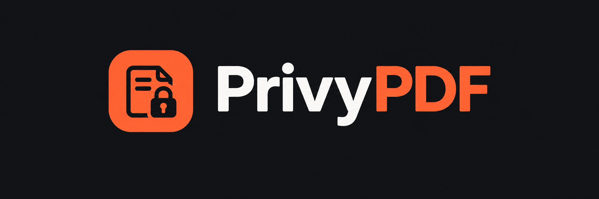

<div align="center">
  
  <h3>Private PDF editing, right in your browser.</h3>
  <p>Organize pages, update supported text, and add annotations. Your files stay on your device.</p>
  <p><strong>Static site · No build step · No uploads</strong></p>
  <p>
    <a href="https://privy-pdf.vercel.app/"></a>
  </p>
  <p><a href="https://privy-pdf.vercel.app/"><strong>🔗 Try PrivyPDF live → privy-pdf.vercel.app</strong></a></p>
  <p>
    
    
    
    
    
    
  </p>
</div>

## Tech stack

- **HTML5 and CSS3** — static pages (`index.html`, `editor.html`, `privacy.html`) styled with a shared stylesheet.
- **Native JavaScript (ES modules)** — all app logic, with no framework and no build step.
- **[PDF.js](https://mozilla.github.io/pdf.js/) (`pdfjs-dist` 6.4.299)** — renders PDF pages and reads existing text in the browser.
- **[pdf-lib](https://pdf-lib.js.org/) 1.17.1** — builds and exports the edited PDF on-device.
- **Self-hosted fonts and libraries** — everything is vendored locally, with no third-party CDN.
- **Vercel** — hosts the official site at [privy-pdf.vercel.app](https://privy-pdf.vercel.app/), with security headers from `_headers`.

## Highlights

- **Keep files local** — PDFs are opened, edited, and exported in your browser.
- **Organize pages** — rotate, reorder, duplicate, delete, insert, and extract pages.
- **Edit and annotate** — Annotate mode offers Drag, Add text with font and style options, Add image, Draw, and Add shape. Tool options open in a contextual horizontal toolbar beneath the main toolbar. In Edit mode, drag-select PDF text to apply Highlight, Underline, Squiggly underline, or Strikethrough precisely to the selected portion; a simple click does not mark the whole text run. Free Text replaces Comment and adds font styling, alignment, dynamic sizing, and text outline controls. Annotation settings are preserved in the downloaded PDF. Shapes provides per-shape Stroke and Fill palettes, opacity, stroke width, line styles, endpoint markers, and freehand Polyline drawing, alongside Undo, Redo, and Eraser. Insert includes a browsable stamp gallery and session-local saved signatures that can be drawn, typed, or uploaded, as well as image and attachment insertion. Forms provides signature, free-text, text-field, checkbox, radio, dropdown, and list-box tools with field-specific defaults, editable choice lists, a field color picker, and a dedicated field list. Form widgets and free text can be moved and resized with selection handles; free text also supports copy, color, link, and delete actions.
- **Fill table cells** — type in empty cells when the PDF has a detectable drawn table grid.
- **Re-edit and move text boxes** — click an added text box to edit it again; use Edit mode to move it.
- **Work with PDFs and images** — open PDF, JPG, and PNG files in one workspace.
- **Undo and redo** — recover from page and annotation changes.
- **Save or download** — Save changes keeps edits marked as saved in the current editor session; Download builds and saves the edited PDF locally.

## Get started

### Use the official website

PrivyPDF is hosted at **[privy-pdf.vercel.app](https://privy-pdf.vercel.app/)**. Open it and choose **Open editor**. There is nothing to install or set up, and your files still stay on your device.

### Run it locally

You can also run your own copy. PrivyPDF is a static site. Serve this folder over HTTP; opening an HTML file directly with `file://` can prevent JavaScript modules and PDF.js workers from loading.

```bash
python -m http.server 8000
```

Then open [http://localhost:8000](http://localhost:8000) and choose **Open editor**.

## Editing existing PDF text

The Select tool is context-sensitive: dashed outlines identify detected PDF text; click supported text to edit it in place, drag it to move it, or click an empty cell in a detectable table to fill it. Existing text edits preserve the original line advance when exporting. The preview samples nearby page colors to better match the page background and text color.

Use the separate **Add text** tool to place text in blank page space. Clicking an existing added text box edits it instead of creating another one. Use **Select and edit text** to move an added text box by dragging it.

When a PDF contains a clear, drawn table grid, the Select tool can detect its cells. Click existing text to edit it, or click an empty cell to add text there. Empty-cell text is a regular text overlay; PDFs without a detectable grid keep the existing text-editing behavior.

Current support covers simple `Tj` and `TJ` text runs, standard-encoded Type1/TrueType fonts with printable ASCII replacements, simple fonts with a single-byte ToUnicode map and width table, and horizontal Identity-H composite fonts with a usable ToUnicode map and CID widths. ToUnicode-based replacements must have an unambiguous character mapping in the source font. Unsupported fonts, characters, or text runs report an export error rather than silently substituting text.

For other content, add a text annotation instead. Text overlays use standard Helvetica fonts; some non-Latin text may need a future embedded-font workflow. Visual cover-and-replace is disabled because it did not securely remove original PDF content.

## Project layout

| Path | Purpose |
| --- | --- |
| `index.html` | Landing page |
| `editor.html` | PDF editor |
| `privacy.html` | Privacy model and verification guidance |
| `css/main.css` | Shared styles and editor/landing-page layout |
| `js/` | Native JavaScript modules |
| `assets/` | Brand logo and icon |
| `vendor/` | Self-hosted PDF.js, pdf-lib, fonts, and PDF.js resources |
| `tests/` | Sample PDFs and manual smoke-test instructions |
| `_headers` | Security headers for compatible static hosts |

## Privacy and dependencies

PDF processing runs in the browser. The project uses self-hosted PDF.js (`pdfjs-dist` 6.4.299), pdf-lib 1.17.1, and local fonts; it requires no third-party CDN or build step. Each HTML page applies a Content Security Policy, and `_headers` provides additional security headers on supported static hosts.

Keep the upstream notices when updating vendored files: `vendor/pdfjs/LICENSE`, `vendor/pdf-lib/LICENSE.md`, and `vendor/fonts/OFL.txt`. PDF.js subcomponent notices are kept with their resources.

## Manual checks

Open `tests/sample.pdf` and verify page rotation, duplication, reordering, deletion, undo/redo, extraction, and download. Open `tests/text-sample.pdf` to test text selection and editing, text insertion and re-editing, text-box movement, table-cell entry where a detectable grid is present, text formatting, image and shape insertion, annotation layer ordering, highlighting, drawing, erasing, and tool toggling. Verify Save changes does not download and Download does. The full scenarios and expected results are in [`tests/README.md`](./tests/README.md).
